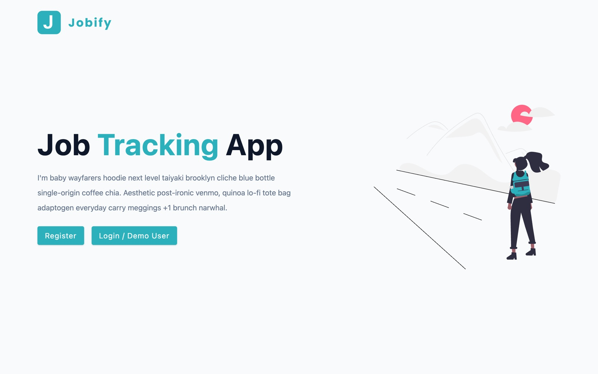

<div align="center">

# 💼 Jobify

A full-stack MERN job tracking app with a React dashboard and an Express and MongoDB API for managing job applications.

<a href="https://github.com/miladmo68/Jobify"></a>
<a href="https://miladweb.com"></a>

</div>

<p align="center">
  
</p>

## ✨ Features

- Landing page with register and login screens
- Dashboard layout with add job, all jobs, stats, profile and admin pages
- Light and dark theme toggle
- Express REST API for creating, reading, updating and deleting jobs
- MongoDB with Mongoose

## 🛠️ Tech Stack

       

> [!NOTE]
> This project needs its own backend, database or API keys, so it runs locally rather than as a static demo.

## 🚀 Getting Started

**Prerequisites:** [Node.js](https://nodejs.org/) 18 or newer · A MongoDB database (local or MongoDB Atlas)

**Clone**

```bash
git clone https://github.com/miladmo68/Jobify.git
cd Jobify
```

**Root**

```bash
npm install
npm run dev
```

**client**

```bash
cd client
npm install
npm run dev
```

### Environment variables

Create a `.env` file (or `.env.local` for Next.js) with:

```env
MONGO_URL=
PORT=
```

## 📁 Project Structure

```
Jobify/
├── client/
├── controllers/
├── errors/
├── middleware/
├── models/
├── routes/
├── package.json
└── server.js
```

## 👤 Author

**Milad Mohammadi** — Frontend-Focused Full-Stack Developer, Toronto 🇨🇦

[](https://miladweb.com)
[](https://www.linkedin.com/in/miladmo68/)
[](https://github.com/miladmo68)

<p align="center"><sub>If you like this project, consider giving it a ⭐</sub></p>
